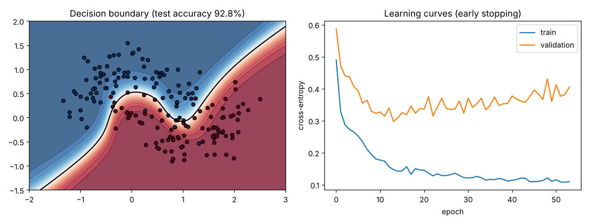
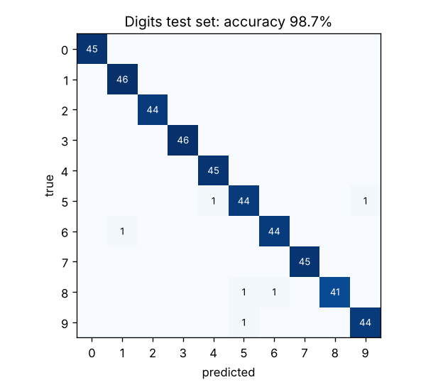

# numpy-neural-net

A small neural-network library written from scratch in NumPy: every forward and
backward pass is derived and implemented by hand, then verified against finite
differences.



## What is inside

| Module | Contents |
|---|---|
| `layers.py` | `Dense` (He / Xavier init), `ReLU`, `Tanh`, numerically stable `Sigmoid` |
| `losses.py` | fused softmax + cross-entropy, binary cross-entropy on logits, MSE |
| `optim.py` | SGD with momentum and weight decay, Adam with decoupled weight decay (AdamW) |
| `network.py` | sequential model, mini-batch training, early stopping that restores the best weights |
| `gradcheck.py` | centred finite-difference gradient check |

## Results

| Data set | Network | Test accuracy |
|---|---|---|
| Two moons (600 points, noise 0.25) | 2-32-32-2, tanh, Adam | 92.8% |
| 8×8 handwritten digits (1,797 images) | 64-128-64-10, ReLU, AdamW | 98.7% |
| same digits, scikit-learn `MLPClassifier`, same layer sizes | reference | 97.6% |

The digits result is in the same range as scikit-learn's implementation, which is a
useful sanity check that the maths and the training loop are right. (A single split
and seed, so treat the 1-point difference as noise, not a win.)



## Correctness

Backpropagation is checked against numerical derivatives for every combination of
activation (ReLU, tanh, sigmoid) and loss (softmax cross-entropy, BCE, MSE); the
largest relative error must stay below 1e-5. Other tests cover numerical stability
for very large logits, learning XOR with both optimisers, and early stopping
restoring the best validation weights.

```bash
pip install -e ".[test,examples]"
pytest
python examples/two_moons.py
python examples/digits.py
```

## Key derivations

For softmax with cross-entropy, the gradient with respect to the logits collapses to

$$\frac{\partial L}{\partial z} = \frac{1}{n}(p - y_{\text{one-hot}})$$

which is why the two are fused in one class: it is cheaper and avoids dividing by
small probabilities. Binary cross-entropy is computed on logits as
$\log(1 + e^{z}) - z\,t$ (via `logaddexp`), which never overflows.

For a dense layer $Y = XW + b$ with upstream gradient $G$:
$\partial L/\partial W = X^\top G$, $\partial L/\partial b = \sum_{\text{rows}} G$,
$\partial L/\partial X = G W^\top$.

MIT licence · Seung Wook Chae
